# Financial News & Social Media Sentiment Analysis Pipeline (2020–2024)


> **Project Context:** This repository showcases my individual workstream for our IS424 Data Mining group project: [**Stock Price Direction Prediction using Machine Learning & Sentiment Analysis (`HengZhengKai/is424-data-mining-project`)**](https://github.com/HengZhengKai/is424-data-mining-project/tree/main).
>
> While the full team project combines **multi-source financial sentiment** with **technical analysis indicators** across 9 ML/DL models to predict 4–10 day stock price movements, **this repository and README focus specifically on the News & Social Media Sentiment Analysis pipeline that I owned and built.**

---

## My Role & Contributions

In our group project, **I led the end-to-end News & Social Media Sentiment Analysis workstream** (Stages 1–3 of the main pipeline), which supplied the daily sentiment features consumed by the team's downstream ML/LSTM trading models:

* **Owned Multi-Source Financial News & Social Media Collection:** Extracted historical stock news from the **FNSPID** corpus (8,500+ tickers) and built custom web scrapers for **MarketWatch** and **Google News** to backfill missing 2020–2024 date windows across `AAPL`, `META`, `NVDA`, `SPY`, `TSLA`, `LLY`, `AMZN`, `MSFT`, and `ORCL`.
* **Built the Data Cleaning & Standardization Pipeline:** Unified **2,033,186 raw records** from **8,057 news publishers** and **3 social media platforms** (Reddit, StockTwits, X/Twitter) into a single canonical schema with ISO-8601 timestamps, URL domain extraction, 512-token truncation, and source-aware deduplication.
* **Executed NLP Sentiment Modeling & LLM Benchmarking:** Selected **`FinBERT-Tone` (`yiyanghkust/finbert-tone`)** as the **final production sentiment model** after benchmarking against **VADER**, **`ProsusAI/finbert`**, and **Llama 3 / 3.1 / 3.2 (1B–8B)**—running batch inference across 5 years of data and engineering the **0.70 News / 0.30 Social Media** daily `Weighted Sentiment Score` (`9,135` stock-date records) fed directly into the final ML/LSTM training datasets.
* **Conducted Text Mining & Sentiment EDA:** Performed bigram topic extraction, word-cloud generation, cross-ticker co-occurrence analysis, and 2020–2024 macroeconomic sentiment regime analysis.

---

## Executive Summary & Key Achievements

* **Large-Scale Multi-Source Data Engineering:** Built an end-to-end data collection, scraping, and standardization pipeline aggregating **2,033,186 combined records** across **8,057 unique news publishers** and **3 major social media platforms** (Reddit, StockTwits, X/Twitter) from **Jan 1, 2020 to Dec 31, 2024**.
* **Custom Gap-Filling Web Scrapers:** Engineered automated date-windowed scrapers for **MarketWatch** and **Google Search/News** (`BeautifulSoup`, `requests`, `newspaper3k`) to bridge coverage gaps in public financial datasets (such as the Dec 16, 2023 cutoff in the **FNSPID** Nasdaq dataset and Meta's `FB` $\rightarrow$ `META` ticker transition).
* **Domain-Specific Transformer & LLM Benchmarking:** Evaluated lexicon-based (**VADER**), finance-tuned BERT (**`ProsusAI/finbert`**, **`yiyanghkust/finbert-tone`**), and generative LLM (**`Llama-3.1-8B-Instruct`**, **`Llama-3.2-3B-Instruct`**, **`Llama-3.2-1B`**) approaches—selecting **`finbert-tone`** (pretrained on 4.9B tokens of corporate filings, earnings calls, and analyst reports) for optimal accuracy-to-throughput across 2M+ records.
* **Source-Weighted Daily Sentiment Index:** Designed a noise-resistant daily aggregation scheme combining continuous polarity scores ($P(\text{Positive}) - P(\text{Negative})$) with source reliability weights (**0.70 Financial News / 0.30 Social Media**), producing **9,135 daily stock-sentiment observations** that helped drive downstream out-of-sample test ROC AUCs of **0.57–0.79** across stocks.

---

## End-to-End Sentiment Pipeline Architecture

```mermaid
flowchart LR
    subgraph S1["1. Multi-Source Data Collection"]
        N1["FNSPID Dataset<br/>(Nasdaq 8.5k+ Tickers)"]
        N2["Custom Web Scrapers<br/>(MarketWatch & Google News)"]
        N3["Public Benchmarks<br/>(Kaggle Financial News)"]
        SM1["Reddit API (PRAW)<br/>(r/wallstreetbets, r/stocks)"]
        SM2["StockTwits & X/Twitter<br/>(Cashtag Streams)"]
    end

    subgraph S2["2. Standardization & Cleaning"]
        C1["Unified 6-Column Schema<br/>(ISO-8601 Datetime, URL Parser)"]
        C2["Source-Aware Deduplication<br/>& 512-Token Length Filtering"]
    end

    subgraph S3["3. NLP Sentiment Inference"]
        M1["VADER Baseline"]
        M2["ProsusAI/finbert"]
        M3["yiyanghkust/finbert-tone<br/>(Selected Production Model)"]
        M4["Llama 3.1 / 3.2 (1B–8B)<br/>(LLM Benchmarking)"]
    end

    subgraph S4["4. Feature Engineering & EDA"]
        F1["Continuous Polarity<br/>(Pos Prob - Neg Prob)"]
        F2["Weighted Daily Aggregation<br/>(0.7 News + 0.3 Social)"]
        F3["Downstream ML/LSTM<br/>& Trading Backtester"]
    end

    S1 --> S2 --> S3 --> S4
```

---

## 1. Multi-Source Data Collection & Web Scraping

### Tickers Covered
* **Primary Modeling Portfolio (2020–2024):** `AAPL` (Apple), `META` (Meta Platforms), `NVDA` (NVIDIA), `SPY` (S&P 500 ETF), `TSLA` (Tesla)
* **Extended Data Collection & Exploratory Scope:** `LLY` (Eli Lilly), `AMZN` (Amazon), `MSFT` (Microsoft), `ORCL` (Oracle)

### Bridging Coverage Gaps Across Sources
No single public dataset provided complete, uninterrupted daily coverage from 2020 through 2024. To construct a continuous 5-year corpus without temporal blind spots, I combined four distinct data streams:

| Data Stream | Role in Pipeline | Key Implementation Details & Repository Links |
| :--- | :--- | :--- |
| **FNSPID (Nasdaq External Data)** | Historical news backbone (up to Dec 16, 2023) | Processed the multi-gigabyte raw Nasdaq corpus in `1,000,000`-row chunks (`finspid.ipynb`) across 8,563 tickers to extract target stock histories (`AAPL`: 9,338 rows; `NVDA`: 11,862 rows; `SPY`: 7,225 rows; `LLY`: 3,545 rows; `FB`: 433 rows). |
| **Custom MarketWatch Scraper** | Backfill post-Dec 2023 cutoff & historical gaps | Built [`news/scraping/scrape_marketwatch.ipynb`](https://github.com/HengZhengKai/is424-data-mining-project/blob/main/news/scraping/scrape_marketwatch.ipynb) to iterate day-by-day (`daterange`) across `marketwatch.com/search`, handling ticker rebrands (`FB` $\rightarrow$ `META` in June 2022) and 2024 out-of-sample test data. |
| **Custom Google News Scraper** | High-recall headline & publisher aggregation | Built [`news/scraping/scrape_google.ipynb`](https://github.com/HengZhengKai/is424-data-mining-project/blob/main/news/scraping/scrape_google.ipynb) (`scrape.ipynb`) using date-bounded query parameters (`tbs=cdr:1,cd_min:...,cd_max:...`) and `User-Agent` rotation, collecting ~95.5k supplementary rows across `SPY` (~38k), `TSLA` (~18.5k), `META` (~14k), `NVDA` (~13k), and `AAPL` (~12k). |
| **Social Media Streams (Reddit, StockTwits, X)** | Retail investor sentiment & momentum signals | Extracted Reddit submissions/comments via `PRAW` ([`social_media/reddit/reddit.py`](https://github.com/HengZhengKai/is424-data-mining-project/blob/main/social_media/reddit/reddit.py)) and cleaned multi-year **StockTwits** ([`social_media/stocktwits/`](https://github.com/HengZhengKai/is424-data-mining-project/tree/main/social_media/stocktwits)) and **X/Twitter** ([`social_media/x/notebooks/`](https://github.com/HengZhengKai/is424-data-mining-project/tree/main/social_media/x/notebooks)) cashtag datasets. |

---

## 2. Data Standardization, Cleaning & Deduplication

Raw data from FNSPID, MarketWatch, Google Search, Kaggle, Reddit, StockTwits, and X arrived with incompatible schemas, mixed timezones, HTML artifacts, and aggregator duplicates.

In [`news/datasets/raw/cleaning_scripts/`](https://github.com/HengZhengKai/is424-data-mining-project/tree/main/news/datasets/raw/cleaning_scripts), [`clean_news.ipynb`](https://github.com/HengZhengKai/is424-data-mining-project/blob/main/news/datasets/raw_post_midterm/cleaning_scripts/clean_news.ipynb), [`clean_all.ipynb`](https://github.com/HengZhengKai/is424-data-mining-project/blob/main/news_social_media_data/cleaning_scripts/clean_all.ipynb), and [`combine_all.ipynb`](https://github.com/HengZhengKai/is424-data-mining-project/blob/main/news_social_media_data/cleaning_scripts/combine_all.ipynb), I standardized all records into a unified 6-column schema:

```text
['Datetime', 'Stock', 'Content', 'Type', 'Source', 'Sentiment']
```

### Key Data Quality Engineering Steps
1. **ISO-8601 Temporal Normalization:** Converted heterogeneous date formats (UTC strings, relative dates, localized timestamps) into strict `%Y-%m-%dT%H:%M:%S` format and filtered to the `2020-01-01` – `2024-12-31` study window.
2. **Automated Publisher Extraction:** Parsed root domain names from raw article URLs via `urllib.parse.urlparse` to track publisher provenance across **8,057 unique news domains**.
3. **Transformer Token-Limit Alignment:** Removed corrupted rows (e.g., newline-only author bylines) and constrained text length to fit within BERT's **512-token (~2,000-character)** context window.
4. **Source-Aware Deduplication:**
   * For **`Type == 'News'`**, deduplicated identical headlines (`subset=['Content']`) caused by syndication across Yahoo Finance, Nasdaq, MarketWatch, and Google News.
   * For **`Type == 'Social Media'`**, preserved recurring retail phrases across *different* dates so genuine surges in retail chatter were not artificially flattened.

---

## 3. Final Sentiment Model Used vs. Alternatives Explored

### Final Production Sentiment Model: **FinBERT-Tone (`yiyanghkust/finbert-tone`)**

The **final sentiment model used** to generate the `Weighted Sentiment Score` feature in the downstream model training datasets ([`training/data/{STOCK}_data_model_training.csv`](https://github.com/HengZhengKai/is424-data-mining-project/tree/main/training/data)) is **`FinBERT-Tone` (`yiyanghkust/finbert-tone`)**, implemented in [`financial-news-sentiment-analysis-finbert tone.ipynb`](https://github.com/HengZhengKai/is424-data-mining-project/blob/main/financial-news-sentiment-analysis-finbert%20tone.ipynb) and aggregated in [`combine_sentiment_scores_per_date.ipynb`](https://github.com/HengZhengKai/is424-data-mining-project/blob/main/combine_sentiment_scores_per_date.ipynb).

#### Why `yiyanghkust/finbert-tone` Was Chosen
* **Domain-Specific Pretraining at Scale:** Built on BERT and pretrained on **4.9 billion tokens** of financial communications (**2.5B tokens** of 10-K & 10-Q corporate filings, **1.3B tokens** of earnings call transcripts, and **1.1B tokens** of analyst reports).
* **Financial Context Accuracy:** Accurately interprets domain-specific phrasing (e.g., *"beats consensus"*, *"guidance raised"*, *"short squeeze"*, *"margin compression"*) that general-purpose lexicons misclassify.
* **High Throughput for 2.03M+ Rows:** Fast enough for full-corpus batch GPU inference across 5 years of data (`2020–2024`), unlike generative LLMs (`Llama-3.1-8B` / `Llama-3.2-3B`).

#### How the Final Sentiment Score Is Calculated (Step-by-Step)
1. **Tokenization & Inference (`yiyanghkust/finbert-tone`):** Each cleaned headline or social media post (`Content`, truncated to $\le 512$ tokens) is passed through `BertForSequenceClassification.from_pretrained("yiyanghkust/finbert-tone")`.
2. **Softmax Probability Extraction:** Model logits are converted via `softmax(dim=-1)` into three class probabilities for every text $i$:
   * $P(\text{Positive}_i)$ (`scores[0]`)
   * $P(\text{Neutral}_i)$ (`scores[1]`)
   * $P(\text{Negative}_i)$ (`scores[2]`)
3. **Continuous Row-Level Polarity Score:** Instead of taking a hard `argmax` label (which discards confidence), a continuous polarity score is computed for each record:
   $$\text{Sentiment\_Score}_i = P(\text{Positive}_i) - P(\text{Negative}_i) \in [-1, 1]$$
4. **Source-Weighted Daily Aggregation (`0.70 News / 0.30 Social Media`):** In [`combine_sentiment_scores_per_date.ipynb`](https://github.com/HengZhengKai/is424-data-mining-project/blob/main/combine_sentiment_scores_per_date.ipynb), records on each date $t$ for stock $s$ are assigned reliability weights ($w_{\text{News}} = 0.70$, $w_{\text{Social Media}} = 0.30$) so high-volume retail chatter does not drown out institutional journalism, and aggregated via a weighted average:
   $$\text{Weighted Sentiment Score}_{s,t} = \frac{\sum_{i \in D_{s,t}} w_{\text{Type}(i)} \cdot \text{Sentiment\_Score}_i}{\sum_{i \in D_{s,t}} w_{\text{Type}(i)}}$$
5. **Downstream Feature Integration:** The resulting daily series (`news_sentiment_finbert_tone_weighted_{stock}.csv`, **9,135 total stock-date rows**) is merged by `Date` directly into [`training/data/{STOCK}_data_model_training.csv`](https://github.com/HengZhengKai/is424-data-mining-project/tree/main/training/data) as the **`Weighted Sentiment Score`** feature alongside `Close` price and the 10 technical indicator combinations (`Combi 1` – `Combi 10`).

#### Sample `FinBERT-Tone` Predictions (Actual Model Outputs)

**1. Row-Level Softmax Probabilities & Continuous Polarity Scores** (from [`financial-news-sentiment-analysis-finbert tone.ipynb`](https://github.com/HengZhengKai/is424-data-mining-project/blob/main/financial-news-sentiment-analysis-finbert%20tone.ipynb) & [`combine_sentiment_scores_per_date.ipynb`](https://github.com/HengZhengKai/is424-data-mining-project/blob/main/combine_sentiment_scores_per_date.ipynb)):

| Date | Stock | Type | Text (`Content`) | `Positive_Sentiment` | `Neutral_Sentiment` | `Negative_Sentiment` | `Sentiment_Score` ($P_{\text{pos}} - P_{\text{neg}}$) |
| :--- | :---: | :---: | :--- | :---: | :---: | :---: | :---: |
| `2020-01-02` | `AAPL` | Social Media | `"$AAPL $295 open."` | `0.999999` | `0.000001` | `0.000001` | **`+0.999998`** |
| `2020-01-02` | `AAPL` | Social Media | `"$AAPL $300 incoming"` | `0.999919` | `0.000059` | `0.000022` | **`+0.999897`** |
| `2020-01-01` | `AAPL` | Social Media | `"$AAPL $DIS I think I nailed this for 2019🤑"` | `0.999434` | `0.000009` | `0.000558` | **`+0.998876`** |
| `2020-01-02` | `AAPL` | Social Media | `"$SPY If you're Bullish you want nasty, ove..."` | `0.162132` | `0.837779` | `0.000089` | **`+0.162043`** |
| `2020-01-02` | `SPY` | News | `"'First five days' indicator, which has a solid..."` | `0.000000` | `1.000000` | `0.000000` | **`0.000000`** |
| `2020-01-02` | `SPY` | News | `"Irrational exuberance? Why last year’s stellar..."` | `0.000097` | `0.012610` | `0.987293` | **`-0.987196`** |
| `2020-01-02` | `SPY` | News | `"Is Google's P/E Ratio Too High Or Too Low?"` | `0.000282` | `0.000010` | `0.999708` | **`-0.999426`** |

**2. Aggregated Daily Weighted Sentiment Output (`0.70 News / 0.30 Social Media`)** (from [`EDA2_sentiment_analysis.ipynb`](https://github.com/HengZhengKai/is424-data-mining-project/blob/main/news_social_media_data/EDA2_sentiment_analysis.ipynb) & [`AAPL_data_model_training.csv`](https://github.com/HengZhengKai/is424-data-mining-project/blob/main/training/data/AAPL_data_model_training.csv)):

| `Date` | `Stock` | `Weighted Sentiment Score` (Daily Aggregated Output) |
| :--- | :---: | :---: |
| `2020-01-01` | `AAPL` | `0.656721` |
| `2020-01-02` | `AAPL` | `0.714227` |
| `2020-01-03` | `AAPL` | `0.654223` |
| `2020-01-04` | `AAPL` | `0.698060` |
| `2020-01-05` | `AAPL` | `0.619414` |

---

### Summary of All Sentiment Models Benchmarked

Before locking in **`yiyanghkust/finbert-tone`** as the final model, I evaluated three other NLP families across the pipeline:

| Model / Approach | Status | Notebook Reference | Why It Was Selected or Rejected |
| :--- | :--- | :--- | :--- |
| **`FinBERT-Tone` (`yiyanghkust/finbert-tone`)** | **FINAL MODEL USED** | [`financial-news-sentiment-analysis-finbert tone.ipynb`](https://github.com/HengZhengKai/is424-data-mining-project/blob/main/financial-news-sentiment-analysis-finbert%20tone.ipynb) | **Selected for final production:** Best balance of financial domain calibration (pretrained on 4.9B financial tokens), deterministic outputs, and inference speed across all 2.03M+ rows. |
| **`FinBERT` (`ProsusAI/finbert`)** | Explored / Benchmarked | [`financial-news-sentiment-analysis-finbert.ipynb`](https://github.com/HengZhengKai/is424-data-mining-project/blob/main/financial-news-sentiment-analysis-finbert.ipynb) | Benchmarked on the 32,228-row January 2020 slice; heavily biased toward `Neutral` (`0.71–0.92`) on informal retail posts compared to `yiyanghkust/finbert-tone`. |
| **Llama 3 / 3.1 / 3.2 (`1B`, `3B`, `8B` Instruct)** | Explored / Rejected | [`news_social_media_data/llama/`](https://github.com/HengZhengKai/is424-data-mining-project/tree/main/news_social_media_data/llama) | **Rejected:** `Meta-Llama-3-8B` (16 GB shards), `Llama-3.1-8B-Instruct`, and `Llama-3.2-3B-Instruct` (6.4 GB) exhausted local memory / timed out, while `Llama-3.2-1B` produced contradictory scores across repeated runs on the exact same text. |
| **VADER (`vaderSentiment`)** | Initial Baseline Only | `Colab_Wk3 Sentiment Analysis using VADER.ipynb` | **Rejected:** Rule/lexicon-based approach lacked financial context (e.g., misinterpreting financial terms and earnings jargon). |

#### Head-to-Head Sentiment Benchmark on Identical Texts (`FinBERT-Tone` vs. `ProsusAI/finbert` vs. `Llama-3.2-1B`)

To empirically compare model behavior before scaling to 2.03M rows, I ran **`yiyanghkust/finbert-tone`**, **`ProsusAI/finbert`**, and **3 independent runs of `meta-llama/Llama-3.2-1B`** on the exact same January 2020 `AAPL` slice ([`financial-news-sentiment-analysis-finbert.ipynb`](https://github.com/HengZhengKai/is424-data-mining-project/blob/main/financial-news-sentiment-analysis-finbert.ipynb) Cells 26 & 47; [`Llama_3_2_1B.ipynb`](https://github.com/HengZhengKai/is424-data-mining-project/blob/main/news_social_media_data/llama/%28inconsistent%2C%20bad%20outputs%29%20Llama_3_2_1B.ipynb) Cell 13):

| Row | Text (`AAPL` — Jan 1, 2020) | `yiyanghkust/finbert-tone` Score ($P_{\text{pos}} - P_{\text{neg}}$) | `ProsusAI/finbert` Score ($P_{\text{pos}} - P_{\text{neg}}$) | `Llama-3.2-1B` Run 1 | `Llama-3.2-1B` Run 2 | `Llama-3.2-1B` Run 3 | Empirical Takeaway |
| :---: | :--- | :---: | :---: | :---: | :---: | :---: | :--- |
| `0` | `"$AAPL I jumped in on the AAPL 300 Jan 31 calls..."` | `0.000000` ($P_{\text{neu}}=1.000$) | `+0.191365` ($P_{\text{neu}}=0.717$) | `+0.925` | `+0.923` | `+0.965` | Options position disclosure without directional catalyst; `FinBERT` models stay neutral/mild. |
| `1` | `"$AAPL they give him air time because 'bad news..."` | `+0.999725` ($P_{\text{pos}}=1.000$) | `-0.055783` ($P_{\text{neu}}=0.894$) | `0.000` | `-0.000` | `-0.436` | `Llama-3.2-1B` drifts from `0.000` to `-0.436` across runs. |
| `2` | `"$AAPL $DIS I think I nailed this for 2019🤑"` | **`+0.998876`** ($P_{\text{pos}}=0.999$) | `+0.068295` ($P_{\text{neu}}=0.888$) | **`-0.999`** | **`-0.000`** | **`+0.939`** | `FinBERT-Tone` captures strong positive conviction (`+0.999`), whereas `Llama-3.2-1B` **flips completely from `-0.999` to `+0.939`** on identical input. |
| `3` | `"$AAPL just bought new iPhone...2 hour free del..."` | `+0.000003` ($P_{\text{neu}}=1.000$) | `+0.145511` ($P_{\text{neu}}=0.828$) | **`-0.944`** | **`+0.909`** | **`-0.000`** | `Llama-3.2-1B` again flips sign (`-0.944` vs. `+0.909`) across runs. |
| `4` | `"$AAPL I usually always buy at the wrong time s..."` | `+0.926194` ($P_{\text{pos}}=0.953$) | `-0.913828` ($P_{\text{neg}}=0.929$) | `-0.000` | `-0.999` | `-0.936` | Self-deprecating/sarcastic retail phrasing shows divergence between pretrained financial models. |

---

## 4. Exploratory Data Analysis (EDA) & Corpus Insights

In [`news_social_media_data/EDA_sentiment_analysis.ipynb`](https://github.com/HengZhengKai/is424-data-mining-project/blob/main/news_social_media_data/EDA_sentiment_analysis.ipynb) and [`news_social_media_data/EDA2_sentiment_analysis.ipynb`](https://github.com/HengZhengKai/is424-data-mining-project/blob/main/news_social_media_data/EDA2_sentiment_analysis.ipynb), I conducted text mining and distributional analysis across the **2,033,186** records and **9,135** aggregated daily stock-date observations:

### Corpus Source & Publisher Distribution (out of 8,057 Sources)

| Rank | Publisher Domain | Article Count |
| :---: | :--- | :---: |
| 1 | **Yahoo Finance** (`Yahoo`) | 23,780 |
| 2 | **Nasdaq** (`Nasdaq`) | 18,932 |
| 3 | **Barron's** (`Barrons`) | 8,742 |
| 4 | **MarketWatch** (`Marketwatch`) | 7,355 |
| 5 | **Bloomberg** (`Bloomberg.com`) | 4,522 |

| Source Breakdown by Stock (`News` vs. `Social Media`) | Social Media Platform Breakdown |
| :---: | :---: |
| 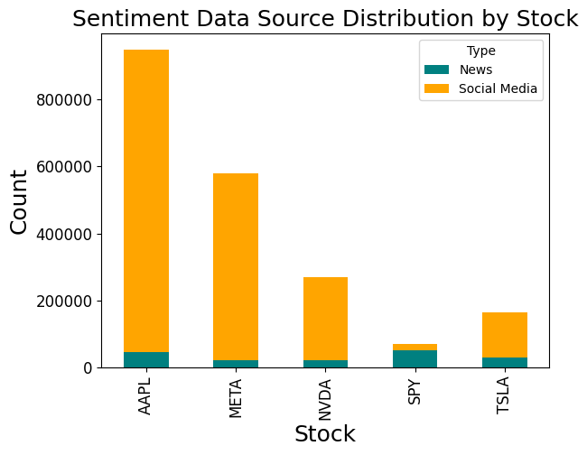 | 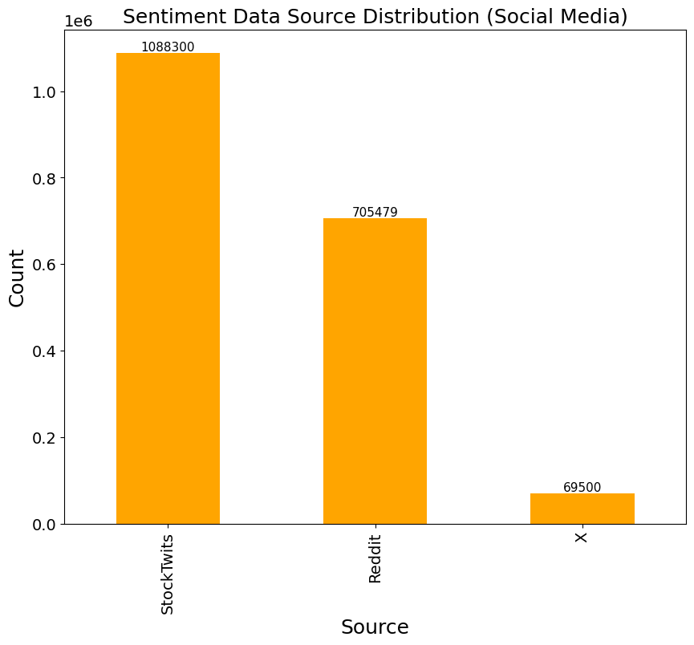 |

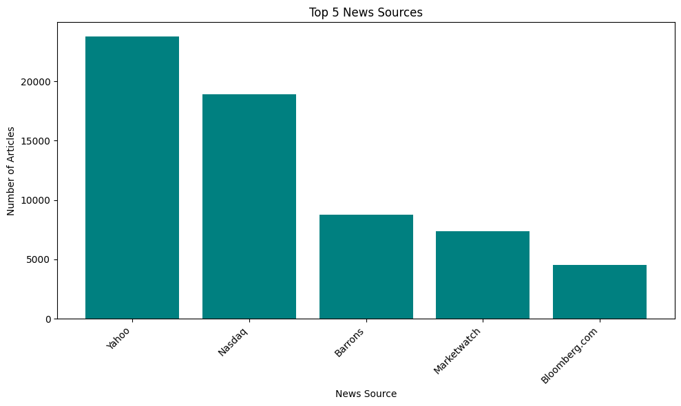

### Cross-Ticker Co-Occurrence & Bigram Themes
* **Top Co-Occurring Stock Pairs:** Extracted cross-mentions across all 2.03M texts, revealing strong macro-tech coupling between `('AAPL', 'SPY')` (**111,111** co-mentions), `('AAPL', 'TSLA')` (**96,652**), `('SPY', 'TSLA')` (**43,051**), `('AAPL', 'NVDA')` (**30,376**), and `('NVDA', 'TSLA')` (**22,893**).

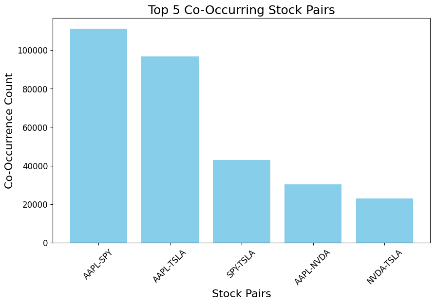

* **Dominant Bigram Topics:** After HTML entity decoding, URL stripping, and custom financial stopword removal, bigram frequency and word-cloud analysis surfaced distinct narratives per ticker—such as *"price target"*, *"data center"*, and *"amd intc"* for **`NVDA`**, versus *"interest rates"*, *"dow jones"*, and *"price action"* for **`SPY`**.

| AAPL Bigram Word Cloud | NVDA Bigram Word Cloud |
| :---: | :---: |
| 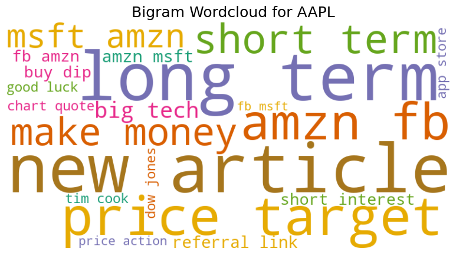 | 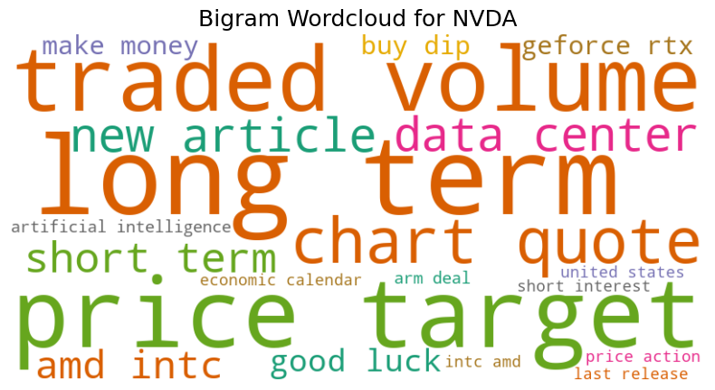 |
| **TSLA Bigram Word Cloud** | **META Bigram Word Cloud** |
| 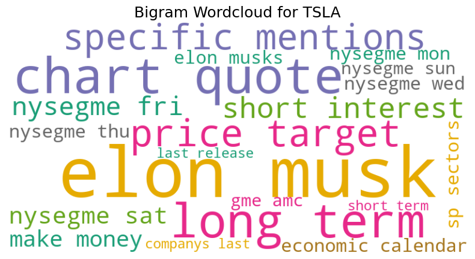 | 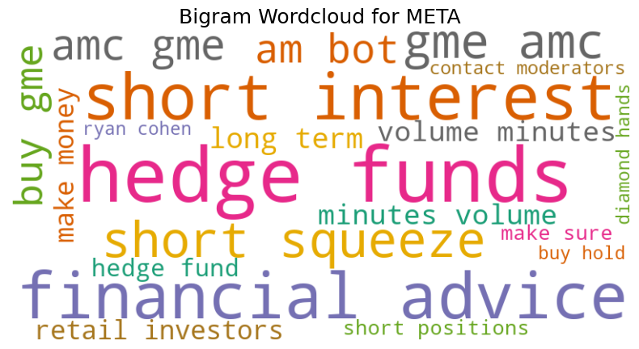 |

<p align="center">
  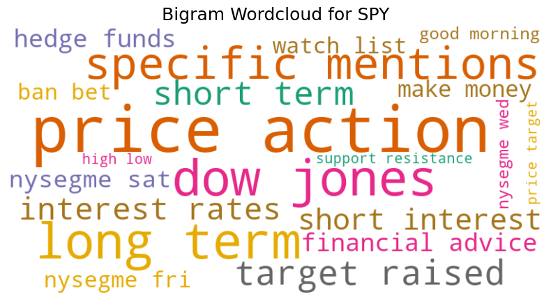
</p>

### Multi-Year Sentiment Regime Shifts (2020–2024)
Analyzing the daily `weighted_sentiment` distributions (KDE plots and yearly trajectories) across the 5 core tickers captured clear macroeconomic regime changes:
* **5-Year Mean Weighted Sentiment:** `META` (`0.725`), `SPY` (`0.712`), `TSLA` (`0.601`), `NVDA` (`0.565`), `AAPL` (`0.565`).
* **2020–2021 Bull Market Optimism vs. 2022–2024 Compression:** Average sentiment peaked during the 2020–2021 liquidity expansion (e.g., `AAPL` at **`0.707`** and `TSLA` at **`0.723`** in 2021) before compressing sharply during the 2022–2024 inflation and rate-hike cycle (`AAPL` at **`0.455`** and `TSLA` at **`0.453`** in 2024).

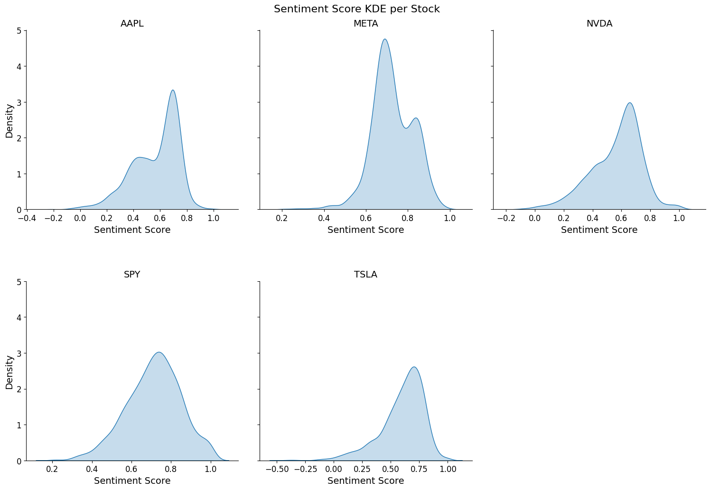

| Yearly Sentiment Trajectory (2020–2024) | 5-Year Average Sentiment per Stock |
| :---: | :---: |
| 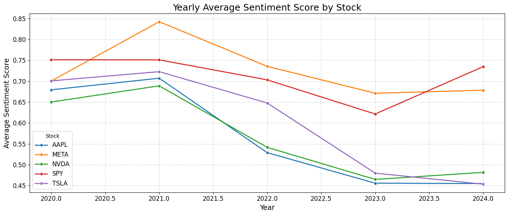 | 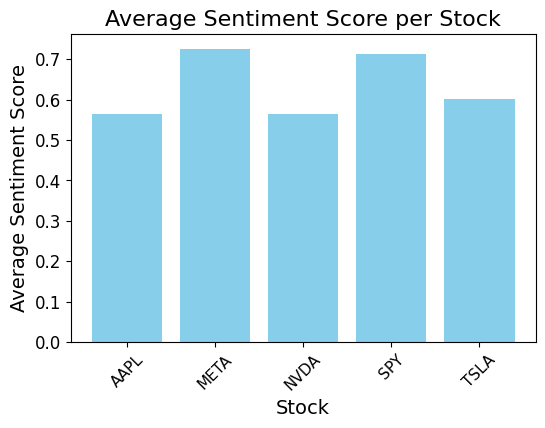 |

---

## 5. How the Sentiment Scores Were Used in Downstream Model Training

Once my pipeline produced the daily **`Weighted Sentiment Score`** (`news_sentiment_finbert_tone_weighted_{stock}.csv`), it was handed off to the group's modeling pipeline ([`training/Final_{STOCK}_model_training.ipynb`](https://github.com/HengZhengKai/is424-data-mining-project/tree/main/training)) as a core predictive feature:

1. **Feature Matrix Integration (`1,267` Trading Days per Stock):**
   * Merged by `Date` into [`training/data/{STOCK}_data_model_training.csv`](https://github.com/HengZhengKai/is424-data-mining-project/tree/main/training/data) alongside the daily `Close` price and **10 technical indicator combinations** (`Combi 1` through `Combi 10`, encoded as `Buy = 1`, `Hold = 0`, `Sell = -1`, plus each indicator's optimal lookahead window `Combi X Days`).
   * For every prediction horizon $h \in \{4, \dots, 10\}$ trading days, the model input vector was constructed directly around the sentiment score:
     ```python
     features = ["Close", "Weighted Sentiment Score"] + rel_signals
     ```
     where `rel_signals` are the technical indicator combinations whose modal optimal horizon equals $h$ days.

2. **Horizon-Specific Return Threshold Optimization:**
   * For each horizon $h$, an automated grid search (`find_best_threshold_for_horizon`) swept return thresholds $\text{th} \in [0.0025, 0.05)$ in increments of `0.0025` to define the binary classification target:
     $$Y_{h\text{d}} = \mathbb{I}\left(\frac{\text{Close}_{t+h} - \text{Close}_t}{\text{Close}_t} > \text{th}\right)$$
   * Evaluated using `XGBoost`, `LightGBM`, and `RandomForest` with `Weighted Sentiment Score` included in the feature set to find the highest-signal return threshold per horizon.

3. **Out-of-Sample Model Training (2020–2023 Train / 2024 Test) & Backtesting:**
   * Using a strict temporal split (**2020–2023** for training, **2024** for out-of-sample testing), the combined feature vector (`Close` + `Weighted Sentiment Score` + technical signals) was used to train and compare **9 ML/DL architectures**:
     * **Tree & Ensemble Models:** Random Forest, XGBoost, LightGBM, Gradient Boosting, Decision Tree
     * **Linear, Kernel & Probabilistic Models:** Logistic Regression, SVM (RBF Kernel), Gaussian Naive Bayes
     * **Deep Learning:** 30-day lookback sequence **LSTM** (`PyTorch`)
   * Across the 5 tickers and prediction horizons, the best horizon models achieved **out-of-sample Test ROC AUCs between 0.573 and 0.857**, driving non-overlapping Long/Short backtests with **10 bps (0.10%) round-trip transaction fees**.

### Downstream Model Benchmarking Results (2024 Out-of-Sample Test Set)

**1. Top Performing Model Configurations per Stock** (from [`training/Final_{STOCK}_model_training.ipynb`](https://github.com/HengZhengKai/is424-data-mining-project/tree/main/training) Cells 6, 19 & 25):

| Stock | Price–Sentiment Correlation ($r$) | Best Horizon ($h$) | Selected Best Model | Optimal Return Threshold ($\text{th}$) | Train ROC AUC (2020–2023) | **Test ROC AUC (2024 Out-of-Sample)** | Test Accuracy | Backtest Highlights |
| :---: | :---: | :---: | :--- | :---: | :---: | :---: | :---: | :--- |
| **`META`** | `+0.0248` | 7-Day | **Logistic Regression** | `0.0425` (4.25%) | `0.6300` | **`0.8568`** | `73.53%` | Selected as best model across all 7 horizons (Avg Test AUC: `0.7866`). |
| **`SPY`** | `+0.0436` | 3-Day / 10-Day | **Gradient Boosting** (3d) / **SVM** (10d) | `0.0375` / `0.0400` | `1.0000` / `0.3186` | **`0.8168`** (3d) / **`0.7722`** (10d) | `99.02%` / `88.24%` | `SVM` selected most frequently (2/4 horizons); Avg Test AUC across horizons: `0.7111`. |
| **`AAPL`** | `-0.4653` | 8-Day (AUC) / 6-Day (Sharpe) | **LSTM** (8d) / **Naive Bayes** (6d) | `0.0400` (8d) / `0.0100` (6d) | `0.7556` / `0.6152` | **`0.6868`** (8d) / **`0.5907`** (6d) | `65.28%` / `61.76%` | **6-Day Naive Bayes achieved `1.531` Sharpe Ratio, `62.50%` Win Rate, and `+34.54%` Total Return** on 2024 test trades. |
| **`NVDA`** | `-0.3361` | 9-Day | **Logistic Regression** | `0.0425` (4.25%) | `0.5899` | **`0.6555`** | `50.00%` | Selected across all 3 horizons (`8d`, `9d`, `10d`); 9-day horizon achieved **`+0.216` Sharpe Ratio** (`45.45%` Win Rate). |
| **`TSLA`** | `+0.0492` | 10-Day / 9-Day | **SVM** (10d) / **Naive Bayes** (9d) | `0.0475` / `0.0450` | `0.7761` / `0.6915` | **`0.5735`** (10d) / **`0.5721`** (9d) | `53.92%` / `51.96%` | 10-day `SVM` achieved `50.00%` Win Rate (`+0.004` Sharpe Ratio). |

**2. Model Family Generalization vs. Overfitting Benchmark (`AAPL` Across All 5 Horizons — Mean ± Std):**

| Model Architecture | Train Accuracy (2020–2023) | Train ROC AUC (2020–2023) | Test Accuracy (2024) | **Test ROC AUC (2024)** | Generalization Takeaway |
| :--- | :---: | :---: | :---: | :---: | :--- |
| **LSTM (30-Day Sequence)** | `0.6641 ± 0.0765` | `0.7195 ± 0.0626` | `0.5028 ± 0.1624` | **`0.5824 ± 0.0988`** | **Best mean Test ROC AUC on `AAPL`**; selected 3/5 times (`4d`, `8d`, `10d`). |
| **Gaussian Naive Bayes** | `0.6203 ± 0.0856` | `0.6415 ± 0.0245` | **`0.6235 ± 0.0685`** | **`0.5800 ± 0.0198`** | **Lowest overfitting gap (`0.0615` AUC diff)** and highest out-of-sample backtest returns (`+29.07%` at 5d, `+34.54%` at 6d). |
| **Logistic Regression** | `0.6380 ± 0.0293` | `0.6635 ± 0.0245` | `0.5373 ± 0.1562` | `0.5268 ± 0.0447` | Stable linear baseline; top performer on `META` (`0.7866` mean Test AUC) and `NVDA` (`0.6453` mean Test AUC). |
| **Random Forest** | `0.9565 ± 0.0269` | `0.9926 ± 0.0099` | `0.5725 ± 0.1249` | `0.5057 ± 0.0516` | High capacity caused severe train memorization (`~0.99` Train AUC vs. `~0.51` Test AUC). |
| **Decision Tree** | `0.9195 ± 0.0346` | `0.9834 ± 0.0134` | `0.5667 ± 0.1121` | `0.4923 ± 0.0171` | Overfit to 2020–2023 regime. |
| **Gradient Boosting** | `1.0000 ± 0.0000` | `1.0000 ± 0.0000` | `0.5843 ± 0.1291` | `0.4480 ± 0.0356` | Memorized training set (`1.000` Train AUC). |
| **XGBoost** | `0.9965 ± 0.0014` | `1.0000 ± 0.0000` | `0.5706 ± 0.1013` | `0.4219 ± 0.0338` | Memorized training set (`1.000` Train AUC). |
| **SVM (RBF Kernel)** | `0.6754 ± 0.0367` | `0.6973 ± 0.0256` | `0.5725 ± 0.1311` | `0.4074 ± 0.0958` | Stronger on `SPY` (`0.6045` mean Test AUC) and `TSLA` (`0.5154` mean Test AUC) than `AAPL`. |

| AAPL Price vs. Daily Weighted Sentiment (`2020–2024`) | AAPL 9-Model Performance & Overfitting Analysis |
| :---: | :---: |
| 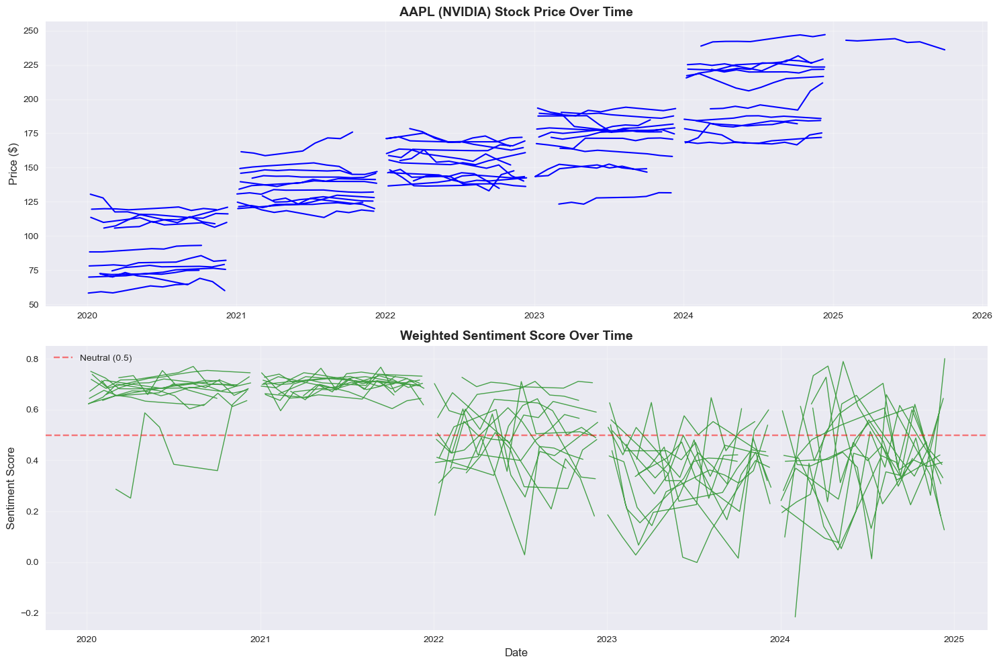 | 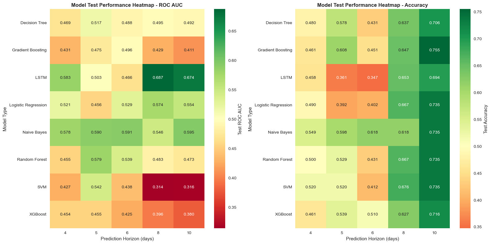 |

---

## 6. Limitations & Future Improvements

### Key Limitations Identified
1. **Pretrained `FinBERT-Tone` Was Not Fine-Tuned on Retail Social Media Slang:**
   * While `yiyanghkust/finbert-tone` was pretrained on 4.9B tokens of formal financial text (10-K/10-Q filings, earnings call transcripts, and analyst reports), we applied it in zero-shot inference mode without fine-tuning on our target social media corpus (`StockTwits`, `Reddit`, `Twitter/X`). As seen in our head-to-head benchmark (e.g., sarcastic retail posts like `"$AAPL I usually always buy at the wrong time..."` or options slang like `"0DTE SPY calls"`), formal financial models can misread informal retail sarcasm and emojis.
2. **Heuristic `0.70 News / 0.30 Social Media` Weighting:**
   * The `0.70` News and `0.30` Social Media weights in [`combine_sentiment_scores_per_date.ipynb`](https://github.com/HengZhengKai/is424-data-mining-project/blob/main/combine_sentiment_scores_per_date.ipynb) were chosen as a domain heuristic to prevent high-volume retail chatter (**1.84M+** StockTwits posts) from drowning out institutional news (**200k+** headlines), rather than being empirically optimized per ticker or market regime.
3. **Contemporaneous Sentiment Does Not Automatically Imply Future Price Movement:**
   * Direct Pearson correlations between daily `Close` price and `Weighted Sentiment Score` were weak or negative across the 5-year window (`AAPL`: `-0.4653`, `NVDA`: `-0.3361`, `META`: `+0.0248`, `SPY`: `+0.0436`, `TSLA`: `+0.0492`). As visible in the `AAPL` price-vs-sentiment chart above, stock prices trended upward in 2023–2024 even as average media sentiment compressed from `~0.71` (2021) to `~0.45` (2024)—demonstrating that public sentiment often acts as a lagging/reactive indicator or reflects macro wall-of-worry narratives already priced in by the market.

### Potential Future Improvements
* **Domain-Specific Fine-Tuning (LoRA / Supervised Adaptation):** Fine-tune `yiyanghkust/finbert-tone` (or a parameter-efficient LoRA adapter) on our specific dataset—for example, using the **self-labeled `Bullish` / `Bearish` tags** already present in our `StockTwits` data (`Sentiment` column) so the model learns retail options jargon, sarcasm, and emojis.
* **Sentiment Ablation Studies:** Run systematic feature ablations comparing *(a) Baseline Without Sentiment*, *(b) News Sentiment Only*, *(c) Social Media Sentiment Only*, and *(d) Combined Weighted Sentiment* to isolate the exact predictive lift of each sentiment source.
* **Alternative Sentiment Aggregation Strategies:** Replace the static `0.70 / 0.30` daily mean with:
  * **Empirically Tuned Source Weights** ($\alpha \in [0, 1]$ optimized via walk-forward validation per stock rather than a fixed heuristic),
  * **Intraday Exponential Time-Decay** (weighting breaking pre-market/after-hours headlines more heavily than older midday posts), and
  * **Sentiment Momentum & Dispersion Metrics** (incorporating day-over-day sentiment shifts $\Delta \text{Sentiment}_{t - k}$ and intraday sentiment variance to capture sudden narrative shocks rather than static daily averages).

---

## Repository Directory Map (My Workstream vs. Full Project)

Below is how the files in this local workspace and the [main group repository (`HengZhengKai/is424-data-mining-project`)](https://github.com/HengZhengKai/is424-data-mining-project/tree/main) map to each stage of the sentiment pipeline:

```text
├── news/
│   ├── scraping/
│   │   ├── scrape_marketwatch.ipynb       # Automated daily MarketWatch headline scraper
│   │   └── scrape_google.ipynb            # Date-windowed Google Search/News scraper
│   └── datasets/
│       ├── raw/cleaning_scripts/          # Per-ticker cleaners (clean_aapl, clean_meta, clean_nvda, clean_spy, clean_lly)
│       └── raw_post_midterm/              # Round 2 expanded scraping & clean_news.ipynb (~95.5k Google Search rows)
│
├── social_media/
│   ├── reddit/                            # PRAW scraper (reddit.py) & per-ticker cleaning notebooks
│   ├── stocktwits/                        # Multi-year StockTwits cleaners (AAPL, META, NVDA)
│   └── x/notebooks/                       # Twitter/X financial & stock tweet cleaning pipelines
│
├── news_social_media_data/
│   ├── cleaning_scripts/
│   │   ├── clean_all.ipynb                # Standardizes News, StockTwits, Reddit, and X into 6-column schema
│   │   └── combine_all.ipynb              # Merges all sources per ticker & runs source-aware deduplication
│   ├── final_combined/                    # Partitioned master datasets (2.03M+ total rows across tickers)
│   ├── llama/                             # Llama 3 / 3.1 / 3.2 (1B, 3B, 8B) local GPU inference benchmarks
│   ├── EDA_sentiment_analysis.ipynb       # Source distribution, bigram extraction, co-occurrence & word clouds
│   └── EDA2_sentiment_analysis.ipynb      # Weighted sentiment KDE distributions & 2020–2024 yearly trends
│
├── financial-news-sentiment-analysis-finbert.ipynb       # ProsusAI/finbert inference pipeline
├── financial-news-sentiment-analysis-finbert tone.ipynb  # yiyanghkust/finbert-tone batch inference by ticker & year
└── combine_sentiment_scores_per_date.ipynb               # 0.7 News / 0.3 Social Media daily weighted sentiment aggregation
```

*(For the downstream technical indicator engineering, 9-model ML/LSTM training, and trading strategy backtesting that consume these sentiment features, see [`time_series/`](https://github.com/HengZhengKai/is424-data-mining-project/tree/main/time_series) and [`training/`](https://github.com/HengZhengKai/is424-data-mining-project/tree/main/training) in the [main repository](https://github.com/HengZhengKai/is424-data-mining-project/tree/main).)*

---

## Tech Stack & Libraries Used

* **NLP & Deep Learning:** `transformers` (Hugging Face), `torch` (PyTorch), `vaderSentiment`, `nltk`, `scikit-learn` (`CountVectorizer`)
* **Web Scraping & APIs:** `requests`, `beautifulsoup4`, `newspaper3k`, `lxml`, `praw` (Reddit API)
* **Data Engineering & Analytics:** `pandas`, `numpy`, `python-dateutil`, `urllib.parse`
* **Visualization:** `matplotlib`, `seaborn`, `wordcloud`

